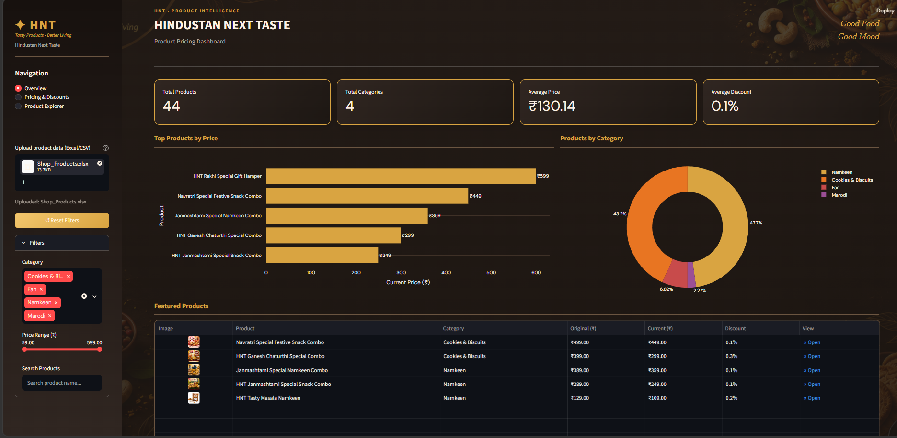
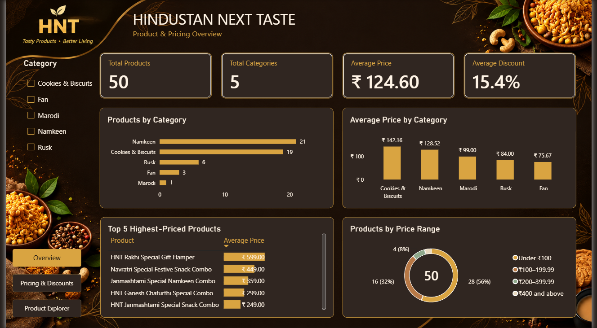
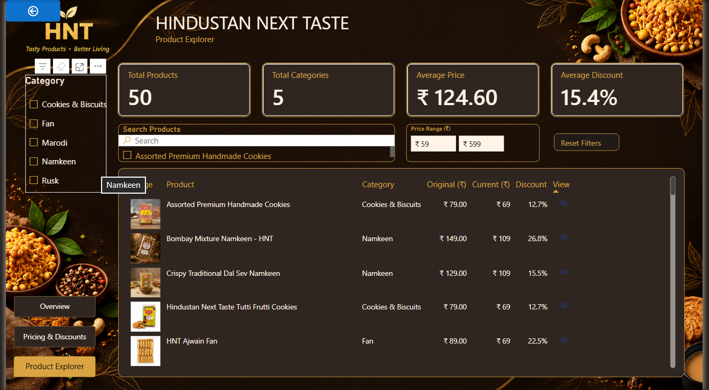

 <div align="center">

# HNT Product Pricing Dashboard

### Product Pricing • Discount Analysis • Product Explorer

A professional, interactive dashboard built with Power BI and Streamlit to explore product pricing, discounts, and catalogue insights.

[](https://hnt-pricing-dashboard-by-sakshi.streamlit.app/)

**[🚀 Open Live Dashboard](https://hnt-pricing-dashboard-by-sakshi.streamlit.app/)**

</div>

---

## Project Overview

The **HNT Product Pricing Dashboard** is an interactive data visualization project designed to make product pricing information easier to understand and explore.

Built using Python and Streamlit, the dashboard combines pricing metrics, discount analysis, interactive charts, and product catalogue information in a modern dark interface with gold accents.

## Dashboard Screenshots

### 1. Dashboard Preview



### 2. Overview



### 3. Pricing & Discounts


### 4. Product Explorer



---

## Key Features

- **Overview Dashboard** — summary metrics and visual insights into the product catalogue.
- **Pricing & Discounts** — compare original and current prices and explore discount patterns.
- **Product Explorer** — browse product details, categories, images, and available links.
- **Interactive Filters** — narrow down displayed data using available filters.
- **Visual Analytics** — explore pricing information through interactive charts.
- **Custom UI** — dark HNT-inspired theme with warm gold highlights.

## Tech Stack

| Technology | Purpose |
|---|---|
| Streamlit | Interactive dashboard interface |
| OpenPyXL | Excel file support |
| Power BI | Dashboard project |

## Project Structure

```text
hnt-product-pricing-dashboard/
│
├── app.py
├── requirements.txt
├── README.md
│
└── assets/
    ├── hnt_background.png
    ├── image_ss.png
    ├── overview.png
    ├── pricing&discount.png
    └── product.png
```

The Excel data file may also be required, depending on how `app.py` loads the product data.

## Getting Started

### Prerequisites

- Python installed on your computer
- pip package manager
- Product dataset required by the application

### 1. Clone the repository

```bash
git clone https://github.com/Sakshi160244/hnt-product-pricing-dashboard.git
```

### 2. Open the project folder

```bash
cd hnt-product-pricing-dashboard
```

### 3. Install dependencies

```bash
pip install -r requirements.txt
```

Your `requirements.txt` should include the packages used by the application, for example:

```text
streamlit
pandas
plotly
openpyxl
```

### 4. Configure the dataset

Place the product dataset in the location expected by `app.py`. If the application expects `Shop_Products.xlsx`, make sure the filename and required columns match the code.

### 5. Run the dashboard

```bash
streamlit run app.py
```

Open the local URL shown in the terminal to view the dashboard.

## Deployment

The dashboard is deployed using **Streamlit Community Cloud**.

**Live Dashboard:** [https://hnt-pricing-dashboard-by-sakshi.streamlit.app/](https://hnt-pricing-dashboard-by-sakshi.streamlit.app/)

1. Push the application files to GitHub.
2. Confirm that `app.py` and `requirements.txt` are present.
3. Ensure required images and data are accessible to the deployed app.
4. Connect the repository to Streamlit Community Cloud.
5. Select `app.py` as the main application file and deploy.

## Data Privacy

- Do not commit passwords, API keys, or confidential business information.
- Only upload product datasets and images you have permission to share.
- For public repositories, use a sanitized dataset if the original data is private.

## Author

**Sakshi**

---

<div align="center">

**HNT Product Pricing Dashboard**

*Built with Power BI • Streamlit • Pandas • Plotly*

[🚀 View Live Dashboard](https://hnt-pricing-dashboard-by-sakshi.streamlit.app/)

</div>
